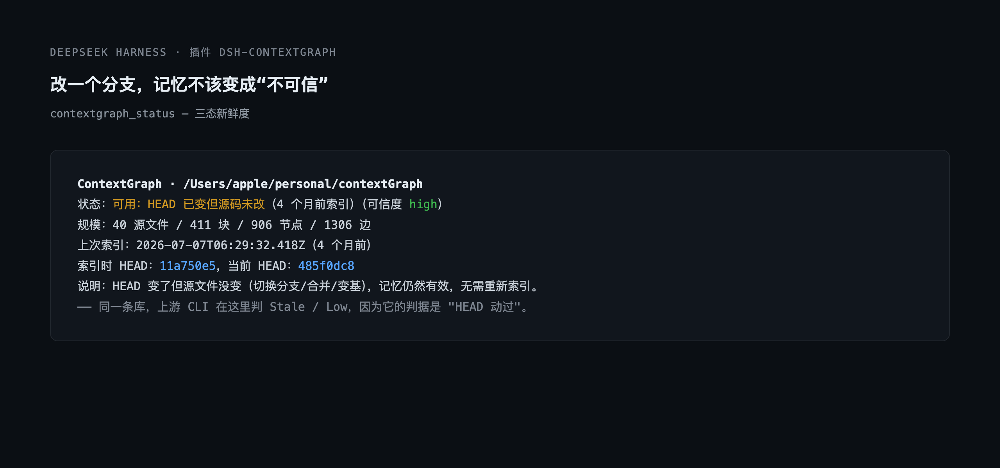
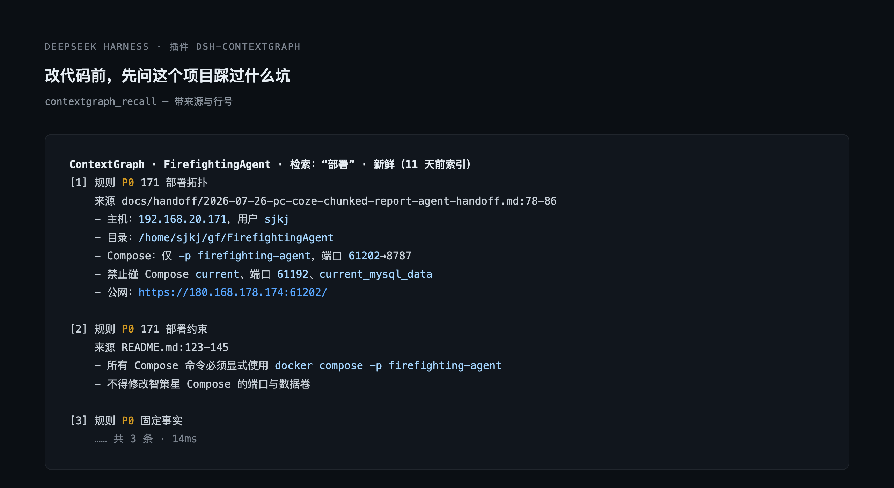
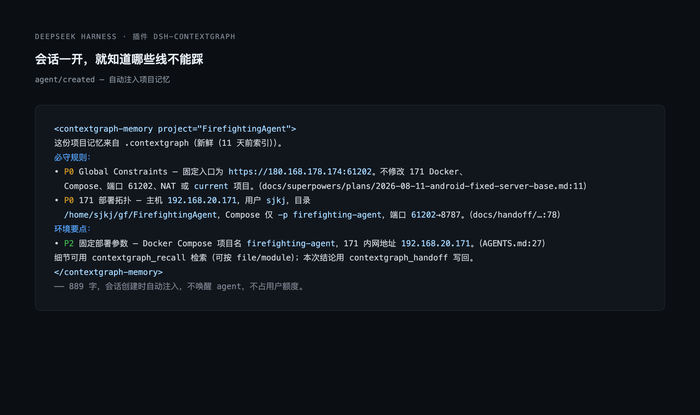

# dsh-contextgraph

把项目里已经存在的 [ContextGraph](https://github.com/StarDreamG/contextGraph) 记忆库接进 DSH agent。



ContextGraph 本身解决的是「项目经验沉淀」：把仓库里的 README、设计稿、交接文档、测试说明切成块，抽成 Rule / Test / Environment / Failure / Decision 等节点，存进 `.contextgraph/graph.db`。问题是它只有 CLI 和 MCP，agent 得手动去查，而且 `contextgraph status` 一看到 git HEAD 变了就把整个库标成 `Stale / Low`，实际上那几百条部署事实并不会因为一次分支切换而失效。

这个插件做三件事：

- **开工自动给简报**：agent 创建时注入一段不到 1000 字的项目记忆，只放必守规则、常用测试命令、环境事实，每条带来源文件与行号。
- **按需精确召回**：`contextgraph_recall` 支持按问题、按文件、按模块查，带 token 预算，结果按「值不值得信」排序。
- **收尾写回**：`contextgraph_handoff` 把本次会话的结论写回同一个记忆库，供后续会话检索。






## 与 `contextgraph query` 的差别

| | CLI | 本插件 |
|---|---|---|
| 新鲜度 | HEAD 一变 → 全库 `Stale / Low` | 区分 `fresh` / `drift`（HEAD 变了但源码没变，仍可信）/ `stale`（列出具体改动文件） |
| 图扩展 | 沿 `co_occurs_with` 扩展 | 完全不扩展。该边是同块节点两两组合，本机某项目有 70794 条，纯噪音 |
| 文件召回 | 无 | `file` 参数 → 该文件抽出的记录 + `RELATED_TO_FILE` / `APPLIES_TO` 关联规则 + `REQUIRES_TEST` 必跑测试 |
| 输出 | 原始记录，截断成 `...` | 字符预算 + 按 block 去重 + 按类型/优先级/事实密度打分 |
| 中文检索 | FTS5 `unicode61` 分词，中文基本搜不到 | LIKE 子串粗筛 + JS 打分，中文按二元组切分 |
| 数据质量 | 不过滤 | 过滤被误判为 `P0 Rule` 的 JSON 导出、markdown 小标题、纯数据文件 |

## 安装

```bash
# 从 GitHub 装
dsh plugin add "github:StarDreamG/dsh-contextgraph"
# 等价写法
dsh plugin add "git+https://github.com/StarDreamG/dsh-contextgraph.git"

# 从本地目录装（开发时用）
dsh plugin add /path/to/dsh-contextgraph
```

装完后重启会话即可生效。没有 `.contextgraph/graph.db` 的项目不会触发任何工具或注入，所以可以全局启用。

前置条件只有一个：目标项目跑过 `contextgraph index`，目录下有 `.contextgraph/graph.db`。插件自带零依赖，不需要 `better-sqlite3`，也不要求 PATH 里有 `contextgraph`。

## 配置

`cordis.patch.yml` 里可调：

| 配置 | 默认 | 说明 |
|---|---|---|
| `autoBrief` | `true` | 是否在 agent 创建时注入简报 |
| `briefBudget` | `900` | 简报字符预算 |
| `recallBudget` | `1600` | 单次 `contextgraph_recall` 字符预算 |

## 工具

### `contextgraph_recall`

```jsonc
{ "query": "部署目录在哪" }          // 自由文本，支持中文子串
{ "file": "tests/auth.test.js" }     // 改这个文件前该知道什么
{ "module": "鉴权" }                 // 按子系统
{ "limit": 8 }                       // 上限 20
```

### `contextgraph_handoff`

```jsonc
{
  "task": "修复 4A 单点登录回调 502",
  "summary": "根因是 upstream 超时配置，改为 60s 后恢复；验证方式：curl 回调地址返回 302。",
  "files": ["src/auth/callback.ts"]
}
```

写入格式与上游 `contextgraph handoff` 一致：`sessions` 一行、`AgentSession` 节点、每个文件一个 `File` 节点与 `RELATED_TO_FILE` 边、FTS 索引同步更新。上游额外的 `classifyBlock` 派生节点没有复刻——那套正则不是存储契约的一部分，猜错会写进一条下次 `contextgraph index` 无法调和的记录。

### `contextgraph_status`

返回状态、可信度、库规模、索引后改动的文件列表，并在需要重新索引时给出提示。

## 分支与发布

插件在日常开发中住在主仓 `StarDreamG/contextGraph` 的 `feat/dsh-contextgraph-plugin` 分支，发布时用 `git subtree split` 生成独立仓库 `StarDreamG/dsh-contextgraph`——因为市场要求仓库名 slug 化，而 `contextGraph` 带大写字母过不了校验。完整流程见 [docs/MAINTAINING.md](docs/MAINTAINING.md)。

## 依赖

零依赖。SQLite 用 Node 24 内置的 `node:sqlite`，不依赖 `better-sqlite3`，也不要求 PATH 里有 `contextgraph`。启动时会有一次 `ExperimentalWarning: SQLite is an experimental feature`，属正常。

## 验证

```bash
node tests/smoke.mjs   # 对本机真实库跑新鲜度 + 召回 + 简报
node tests/head.mjs    # HEAD 比较的回归测试
```

本机实测（2026-11-09）：

| 项目 | 源文件 | 节点 | 新鲜度 | 评估耗时 | 召回耗时 |
|---|---|---|---|---|---|
| FirefightingAgent | 365 | 7632 | `fresh` / high | 23ms | 14ms |
| batch-transfer-platform | 84 | 2974 | `stale` / medium | 32ms | 40ms |
| dify-frontend | 5268 | 11872 | `stale` / medium | 77ms | 257ms |

`drift` 没有出现在这张表里，是因为它只在"索引后切过分支/合并过，但工作区文件一个都没动"时出现——那正是上游判 `Low` 而本插件判 `high` 的场景。
